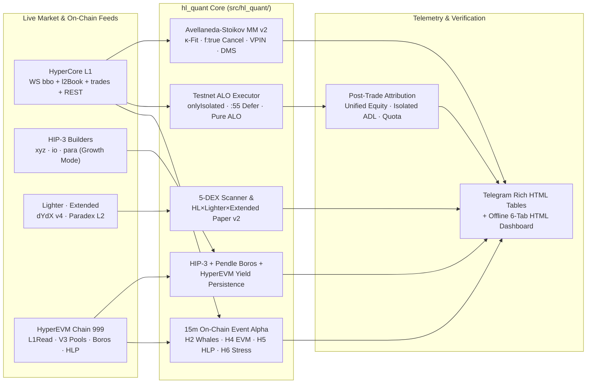

<p align="center">
  
</p>

<p align="center">
  <a href="docs/wiki/Home.md"><b>Full Technical Docs &amp; Wiki (8 pages)</b></a> ·
  <a href="docs/reports/2026-11-26/hl_defi_trader_portfolio_brief.md"><b>Portfolio &amp; Case Studies (EN + RU)</b></a> ·
  <a href="docs/reports/2026-11-26/hl_trading_tear_sheet.md"><b>Executive Tear-Sheet</b></a> ·
  <a href="docs/reports/2026-11-26/hl_desk_dashboard.html"><b>Offline 6-Tab HTML Dashboard</b></a>
</p>

---

## Verified Live Results

Standalone Python package **`hl_quant`** (`src/hl_quant/`, zero external monorepo dependencies, **135 passing unit tests**, zero warnings, **7 automated ops crons**). Every number below comes from live Hyperliquid Mainnet feeds, Hyperliquid Testnet executions, HyperEVM Chain 999 RPC (`eth_call`), Pendle Boros Open API, and reproducible OOS studies.

| Module | Scope | Verified Result | Report / Proof |
|---|---|---|---|
| **6-Family Metamodel Audit** | 58 hypotheses + 60m live `bbo` ALO audit (19 alts) | Ideal `1.5 bps`: `+32.18% APR / Sh 3.11`; at **measured `5.0 bps` BBO cost** (`55%` fill, negative 30s markout): collapses to 1 carry layer, **Ex-`INIT` −0.37% / Sh −0.19** → honestly kept **observation-only** (`5.0 bps` paper) | [BBO ALO Audit](docs/reports/2026-11-26/hl_alo_fill_portfolio_coins.md) · [Real-Cost Metamodel](docs/reports/2026-11-26/hl_metamodel_real_costs.md) · [Slow Rev Test](docs/reports/2026-11-26/hl_xs_rev_slow_variants.md) |
| **Testnet `ALO` Executor & Attribution** | 4h `Alo` rebalancer + 09:00 UTC daily audit | **95.7% real `ALO` Fill Rate (`22/23`)**, VW Markout **`+2.33 bps`**, exact `Unified Account` sync, `onlyIsolated` guard, **isolated/cross `ADL Rank`** & **size-scaled / Growth `0.1×` API quota health** | [Testnet Execution Docs](docs/wiki/Hyperliquid-Testnet-Execution-and-Attribution.md) |
| **Avellaneda–Stoikov MM v2** | Mainnet WS $\kappa$-fit + live `BTC+ETH` Testnet | `ETH κ=0.544`, `BTC κ=0.327`; **100% Maker, +$0.0165 net PnL, ETH +4.51 bps 5s markout**; **`p50 = 5.62 µs`**; **`f: true` fast-cancel priority**, pure `Alo` batch guard, `Standard` mempool check, **rolling VPIN** & **adaptive `1 req/$` (`0.1×` Growth) throttle** | [Calibration Report](docs/reports/2026-11-26/hl_mm_ws_calibration.md) |
| **5-DEX Scanner v2 + Cross-DEX Paper v2** | 810 perps + 4h **HL × Lighter × Extended** cron | Persistence Gate (`>=2` ticks), tight L2 cap (`<=5 bps`), **H1 Basis+Carry Combo** live on Extended (`NEAR +18.8% APR`, `+13.6 bps` exec basis, **2h payback**) | [5-DEX Scan](docs/reports/2026-11-26/hl_cross_dex_v2_scan.md) · [Paper v2 Log](docs/reports/2026-11-26/hl_cross_dex_paper_live.md) |
| **HIP-3 Builder-Perps (`xyz`/`io`/`para`)** | **10 builders, 178 markets, `$2.2B/24h`** + **Growth Mode** & **Oracle Div Guard** | Zero-bridge same-chain arb in **Growth Mode (`0.90 bps` taker / `0.30 bps` maker, 30d cooldown tracker, independent DEX margin)**: **`xyz:NVDA / io:NVDA` `+77.5% APR` (`5h/8h` payback)**, **`SKHX +75.2%` (`⚠️ 46.0 bps` oracle div flagged!)**, 4h persistence tracker | [HIP-3 Live](docs/reports/2026-11-26/hl_hip3_builder_arb_live.md) · [Frontier Persistence](docs/reports/2026-11-26/hl_frontier_persistence_live.md) |
| **Pendle Boros & HyperEVM Yield Stack** | **39 active Boros** (`17` HL/Spread) + `kHYPE/Felix/HyperLend` vs `HLP` | Boros locks **`HYPE +8.94%` / `BTC +6.69%`** (28d) & `HL-Gate ETH` spread `+6.36%` disloc; composable `kHYPE+Boros` loop nets **`+9.07%`** vs passive **`HLP +15.68%`** | [Boros Live](docs/reports/2026-11-26/hl_boros_fixed_funding_live.md) · [Yield Stack](docs/reports/2026-11-26/hl_hyperevm_yield_stack_live.md) |
| **HyperEVM (999) + HLP + H2/H4/H5/H6 Events** | `L1Read`, V3 depth, **leveraged whale H2**, **deposit-clean HLP PnL**, **3-regime H6** (15m cron) | `L1Read`: **0.00 bps** BTC/ETH drift; `USDT0` `+11.08 bps` peg adj; live **`ETH $52.0M`** liq wall (`4.5%`); **`INIT -110.9 bps` (`-840%` APR)** cleanly classified as `CROWDED_FUNDING_BASIS`; deposit-clean HLP `allTime.pnlHistory` + **4h alert cooldown** + **6h whale cache** | [HyperEVM Scan](docs/reports/2026-11-26/hl_hyperevm_defi_scan.md) · [H2–H6 Live](docs/reports/2026-11-26/hl_onchain_events_h2_h4_h5_live.md) |
| **52d `:00` Hourly Funding OOS Study** | **51 coins / 60,370** `:00` events (`52d 15m` + `17d 5m`) | `APR<=-25%`: fast `0–5m` unwind (`+3.84/+2.27 bps`) wired into MM/Executor; `APR>=+50%`: `naive_harvest_15m` yields **`+21.48 bps` Net Maker** Holdout (`t=+2.3`, `ex-XMR +33.6 bps`) | [17d `5m` Study](docs/reports/2026-11-26/hl_hourly_funding_settlement_study.md) · [52d `15m` Study](docs/reports/2026-11-26/hl_hourly_funding_settlement_52d_study.md) |

---

## Core HyperCore Microstructure Safeguards

- **Mempool Priority Discipline:** Explicit fast cancel (`f: true`) + pure `Alo`-only batches (`ValueError` on mixed `GTC`/`IOC`) + startup `userAbstraction` audit (`Standard` mode required for HyperCore mempool prioritization; `Unified Account` / `Portfolio Margin` explicitly flagged).
- **Rate-Limit & Growth Mode Accounting:** Adaptive requote governor and post-trade quota audit scale both by HyperCore's `1 req / 1 USDC` budget (with **`-90%` / `0.1×` volume weight in HIP-3 Growth Mode → `1 req / 10 USDC`**) and by average order size (`1%` fill floor at `$100` vs `0.05%` at `$2,000`).
- **Execution-First Honesty:** Rejected a `+32% APR` paper alpha before committing live capital after a 60-minute live `bbo` recording proved real altcoin passive cost is `5.0 bps` (`55%` fill rate), then focused engineering on verified structural edges (HIP-3, Boros, Cross-DEX L2, `:00` overlays, MM).
- **True On-Chain Risk Hygiene:** Deposit-clean HLP PnL (`vaultDetails.portfolio.allTime.pnlHistory`), exact `isolated` (`marginUsed`) vs `cross` (`accountValue`) `ADL Rank` denominators, independent HIP-3 DEX margin accounting, and `USDT0/USDC` peg adjustment.

---

## System Architecture



---

## Quick Start

Requires **Python >= 3.11.5**.

```bash
# 1. Install environment, dev tools & optional Testnet SDK
uv sync --extra dev --extra testnet

# 2. Run lint and the full 135-test unit suite
make lint
make test

# 3. Safe 100% read-only live scans (no API keys required)
make scan-hip3
make scan-boros
make scan-evm
make bench-mm

# 4. Build the offline 6-tab interactive HTML desk dashboard
make dashboard
```

---

## Automated Operations & Safety Guardrails

All live execution code is hard-pinned to **`https://api.hyperliquid-testnet.xyz`** (zero Mainnet private keys or withdrawal permissions). Copy `.env.example` to `.env` for optional Testnet/Telegram keys.

| Cadence | Wrapper Script | Role |
|---|---|---|
| Hourly `:50` | `scripts/ops/run_hyperliquid_snapshot_tick.sh` | Live `predictedFundings` & market snapshots |
| Every 4h `:05` | `scripts/ops/run_hl_metamodel_paper_tick.sh` | Observation-only shadow paper tracker at measured `5.0 bps` HL cost |
| Every 4h `:10` | `scripts/ops/run_hl_testnet_executor_tick.sh` | Live Testnet `ALO` rebalancer (`cross:3x`, `onlyIsolated` guard, kill-switch) |
| Every 4h `:15` | `scripts/ops/run_hl_cross_dex_paper_tick.sh` | Cross-DEX Paper v2 (**HL × Lighter × Extended**, Persistence + Slip `<=5 bps` + H1 Combo) |
| Every 4h `:20` | `scripts/ops/run_hl_frontier_persistence_tick.sh` | Frontier Persistence Tracker (**HIP-3** Growth/Oracle + **Pendle Boros** + **HyperEVM Yield Stack**) |
| Every 15m (`*/15`) | `scripts/ops/run_hl_onchain_event_tick.sh` | On-Chain Event Alpha (**H2** Leveraged Whales + **H4** EVM + **H5** Deposit-Clean HLP + **H6** 3-Regime Stress + **4h Cooldown**) |
| Daily `09:00 UTC` | `scripts/ops/run_hl_testnet_attribution_daily.sh` | Post-trade PnL, Maker %, `ALO` Fill Rate, `ADL Rank`, API quota + quiet HTML dashboard refresh |

Install or migrate all 7 local crons cleanly in one command:
```bash
zsh scripts/ops/install_all_hl_crons.sh
```

---

## Repository Layout

- `src/hl_quant/` — 28 reusable quantitative research, market making, execution, 5-DEX, HIP-3, Boros, HyperEVM, and attribution modules.
- `scripts/analytics/` — 25 thin Typer CLI entrypoints for live scans, calibration, backtests, and dashboard builds.
- `scripts/ops/` — lock-aware shell wrappers and idempotent local cron installers (`install_all_hl_crons.sh`).
- `tests/` — 25 test modules (**135 unit tests**), CI-verified on GitHub Actions (`ruff` + `pytest`).
- `docs/reports/` — dated reproducible research reports, live snapshots, EN+RU portfolio brief, and self-contained offline HTML dashboard.
