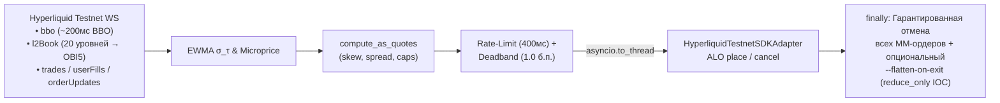

# Маркет-мейкер Avellaneda–Stoikov (WebSocket `bbo + l2Book`)

Полноценный прототип пассивного двустороннего маркет-мейкера на **Hyperliquid Testnet** с масштабно-инвариантной формулировкой Avellaneda–Stoikov (2008) / GLFT, эмпирической калибровкой интенсивности прихода ордеров $\kappa$ на реальных тиках и субсекундным WebSocket-потоком.

**Файлы:**
- Движок, калибровка и WS-цикл: `src/hl_quant/hl_mm_avellaneda_stoikov.py`
- CLI живой сессии / реплея: `scripts/analytics/run_hl_mm_testnet.py`
- CLI калибровки $(\gamma, \kappa)$: `scripts/analytics/run_hl_mm_calibration.py`
- Тесты: `tests/test_hl_mm_avellaneda_stoikov.py`
- Отчёт калибровки и сравнения прогонов: `docs/reports/2026-11-26/hl_mm_ws_calibration.md`

---

## Математическая модель (в базисных пунктах — scale-invariant)

Классическая формула в абсолютных долларах ломается при переходе между BTC (`60 000 USD`) и альтами (`0.01 USD`). Движок работает в **базисных пунктах (б.п.)**, поэтому параметры $(\gamma, \kappa)$ физически интерпретируемы и инвариантны к цене актива:

1. **Микроструктурная справедливая цена (Stoikov microprice + наклон OBI5):**
   $$s_{\text{micro}} = \frac{B \cdot V_A + A \cdot V_B}{V_B + V_A}, \qquad s_{\text{fair}} = s_{\text{micro}} \cdot \bigl(1 + \alpha_{\text{obi}} \cdot \text{OBI}_5 \cdot 10^{-4}\bigr)$$
2. **Онлайн-оценка волатильности EWMA $\sigma_\tau$:**
   - Взвешенная по $\Delta t$ дисперсия лог-доходностей с винзоризацией выбросов, масштабированная на горизонт удержания инвентаря $\tau$ (`horizon_sec = 30s`).
3. **Цена резервирования (inventory skew):**
   - Нормализованный инвентарь $q = q_{\text{usd}} / Q_{\max} \in [-1, 1]$:
   $$\Delta r_{\text{bps}} = -q \cdot \gamma \cdot \sigma_\tau^2, \qquad r = s_{\text{fair}} \cdot (1 + \Delta r_{\text{bps}} \cdot 10^{-4})$$
   При длинном инвентаре ($q > 0$) обе котировки сдвигаются вниз (мотивируя продажи и тормозя новые покупки); при коротком — симметрично вверх.
4. **Оптимальный спред и защита комиссий:**
   $$\delta_{\text{total, bps}} = \left(\gamma \cdot \sigma_\tau^2 + \frac{2}{\gamma}\ln\!\left(1 + \frac{\gamma}{\kappa}\right)\right) \cdot m_{\text{tox}}$$
   - Пол полуспреда: `half_spread_bps >= max(min_half_spread_bps, maker_fee_bps + min_edge_bps)` (на Hyperliquid Tier-0 `1.5 + 1.0 = 2.5 б.п.`).
   - Жёсткий post-only кламп: `bid_px <= best_bid`, `ask_px >= best_ask` (`Alo`, ноль taker-кроссов).
5. **Асимметричный сайз, капы и защитные паузы:**
   - При $|q_{\text{usd}}| \ge Q_{\max}$ наращивающая сторона отключается полностью, а разгружающая получает `reduce_only=True`.
   - **Queue-preserving deadband** (`requote_threshold_bps = 1.0 б.п.`): не отменяет ордер при мелком шуме, сохраняя приоритет в очереди Hyperliquid.
   - **Circuit breakers:** пауза/снятие котировок при скачке волатильности (`> vol_halt_sigma_bps`), аномальном спреде стакана (`> max_book_spread_bps`), токсичном markout (`< adverse_markout_widen_bps` → расширение `1.5×`) или просадке сессии (`> max_session_drawdown_usd`).

---

## Эмпирическая калибровка $(\kappa, A, \sigma)$ на реальном потоке

Функция `calibrate_as_arrival_intensity` оценивает кривую прихода ордеров $\lambda(\delta) = A \cdot e^{-\kappa \delta}$ методом пуассоновской инверсии (GLFT) по скользящим окнам `window_sec = 5s`:
$$\hat{\lambda}(\delta) = -\frac{\ln(1 - \hat{p}_{\text{fill}}(\delta))}{W}$$
и подгоняет взвешенную лог-линейную регрессию $\ln\hat{\lambda}(\delta) = \ln A - \kappa\delta$.

### Живой замер (Hyperliquid Mainnet WS, 60с, 312 сделок)

| Монета | $\hat{\sigma}_{1s}$ | $\hat{\sigma}_{30s}$ | $\hat{\kappa}$ (1/б.п.) | $\hat{A}$ (1/с) | $R^2$ | $1/\hat{\kappa}$ (б.п.) |
|---|---:|---:|---:|---:|---:|---:|
| **ETH** | 1.40 б.п. | 7.7 б.п. | **0.544** | 0.080 | **0.83** | 1.84 |
| **BTC** | 1.00 б.п. | 5.5 б.п. | **0.327** | 0.065 | **0.98** | 3.06 |

---

## Архитектура WebSocket-цикла (`bbo + l2Book + trades + userFills + orderUpdates`)

- **Полная изоляция от позиций метамодели:** MM отслеживает только собственные `all_mm_oids` и считает дельта-инвентарь относительно `start_inventory_sz` — никогда не трогает ордера других стратегий.
- **`--flatten-on-exit`:** после отмены всех активных котировок автоматически закрывает остаточный дельта-инвентарь сессии `reduce_only Ioc`-ордером.

---

## Эволюция живых результатов на Hyperliquid Testnet (`BTC` и `ETH`)

| Метрика | 1. REST (`κ=0.35`) | 2. WS `l2Book` (`κ=0.5436`) | 3. WS `bbo+l2Book` (`ETH`) | **4. Multi-Coin v2 (`BTC+ETH`, Lead-Lag + `batchModify` + `scheduleCancel`)** |
|---|---:|---:|---:|---:|
| Быстрых `bbo`-тиков | 0 | 0 | 20 | **36 (`20` BTC + `16` ETH)** |
| Атомарных `batchModify` | 0 | 0 | 0 | **16 (`9` BTC + `7` ETH)** |
| Binance Lead-Lag toxic pull | 0 | 0 | 0 | **5 (на ETH)** |
| Живые сделки (Buy / Sell) | 3 (3B/0S) | 4 (2B/2S) | 9 (5B/4S) | **15 (`4B/1S` BTC + `10B/0S` ETH)** |
| Оборот / Maker доля | 28.04 USD · 100% | 36.53 USD · 100% | 133.40 USD · 100% | **150.13 USD · 100%** |
| **Итого Net PnL (после комиссий)** | −0.0042 USD | +0.0066 USD | +0.0057 USD | **+0.0165 USD (`+0.0056` BTC + `+0.0109` ETH)** |
| **Post-Fill Markout +5s** | +0.23 б.п. | +2.81 б.п. | +1.96 б.п. | **+4.51 б.п. (ETH с Lead-Lag защитой!)** |
| Открытые ордера после выхода | 0 | 0 | 0 | **0 (flatten `0.00028 BTC` + `0.063 ETH`)** |

### Проп-механики v2
- **Binance Futures Lead-Lag (`LeadLagEstimator`):** вычитает медленный EWMA-базис (`half_life = 45с`), сдвигает `fair_px` пропорционально мгновенному импульсу и мгновенно снимает уязвимую сторону при прыжке Binance `>= 2.0 б.п.`.
- **Атомарный `batchModify` vs приоритетный `cancel` в HyperCore (`prefer_explicit_cancel` + `Standard` check):** в мемпуле HyperCore приоритет перед входящими IOC-ордерами получают **явные канонические `cancel` (`{"a", "o"}`) и чистые `Alo`-батчи**, и **только в режиме `Standard`** (`Unified Account` / `Portfolio Margin` отключают приоритет мемпула!). Спокойные перекотировки идут через `batchModify`, а на токсичном импульсе Binance Lead-Lag / VPIN (`>= 0.75`) движок шлёт явный `cancel` + чистый `Alo`-батч (смешивание с `GTC`/`IOC` заблокировано `ValueError`) и проверяет `userAbstraction` на старте сессии. Дедупликация частичных филлов строится по уникальному `tid`.
- **Адаптивный Rate-Limit Governor (`compute_adaptive_action_interval_ms`):** по мере роста `api_reqs / effective_volume_usd` (с учётом **штрафа `-90%` в HIP-3 Growth Mode → `1 req / 10 USDC`**) плавно замедляет спокойные перекотировки (`2× / 4× / 8×`), предотвращая бан `1 req / 10s`.
- **Нативный `scheduleCancel` (Dead Man's Switch):** защитный таймер на стороне движка Hyperliquid. При выходе он разоружается (`schedule_cancel(None)`) только после того, как `openOrders` подтвердил, что ни одного MM-ордера не осталось (с повторной отменой остатков). Если отмена или проверка не удалась, DMS остаётся взведённым, чтобы биржа сама сняла остатки, а в итоге сессии ставится `dms_left_armed=true`.
- **reduce-only по реальной позиции аккаунта:** лимиты и skew считаются от инвентаря сессии, но флаг `reduceOnly` (на котировках и на flatten-IOC при выходе) ставится, только если ордер действительно сокращает позицию всего адреса (`start_sz + net_sz`). Иначе Hyperliquid отклонял бы ордер на общем с ребалансером адресе.
- **Кросс-активное бета-хеджирование:** в мульти-монетном режиме (`run_multi_coin_mm_ws_session`) перекос инвентаря одной монеты частично переносится на котировки остальных через `portfolio_beta_coupling = 0.25`.
- **Бенчмарк горячего пути:** `p50 = 5.62 мкс`, `p95 = 5.83 мкс`, `p99 = 6.67 мкс` (`175 088` тиков/сек).

- **`:00` Hourly Funding-Unwind Overlay (`compute_funding_settlement_overlay_bps`):** на основе 17-дневного OOS-исследования (17 874 расчёта) в окне `:59→:05` UTC на монетах с `|APR| >= 25%` котировки MM автоматически смещаются на `−2.5 б.п.` без дополнительных комиссий.
