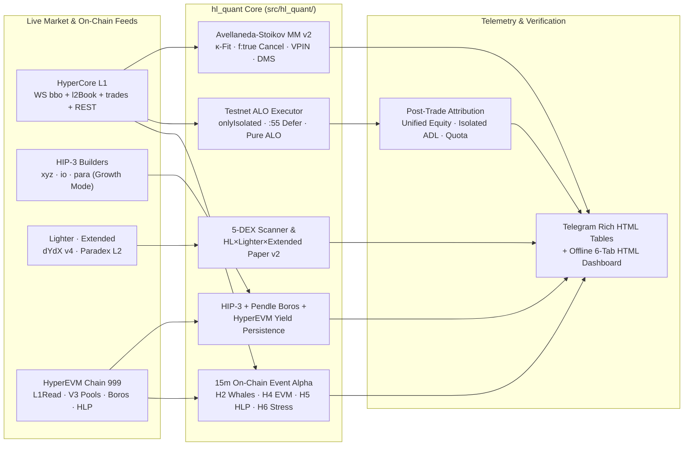

# `hyperliquid-quant-defi` (`hl_quant`) — Техническая Wiki

Добро пожаловать в полную инженерную документацию автономного стека **`hyperliquid-quant-defi`** (`src/hl_quant/`, **135 unit-тестов** на GitHub Actions CI, **7 автоматических cron-контуров**, нулевые внешние зависимости от монорепозиториев).

---

## Архитектура системы



---

## Навигация по Wiki

| Раздел | О чём страница |
|---|---|
| [🧬 Альфа-фабрика и аудит издержек (`1.5 → 5.0 б.п.`)](Hyperliquid-Alpha-Research-and-Metamodel) | 58 гипотез в 6 семействах, 60-мин `bbo` аудит реального `ALO` fill rate (`55%`), честный перевод метамодели в observation-only |
| [📈 Paper L2 трекер, Микроструктура и 5-DEX v2](Hyperliquid-Paper-Tracker-and-Cross-DEX) | 5-DEX сканер (`810` перпов), Cross-DEX Paper v2 (`HL × Lighter × Extended`), Persistence Gate и H1 Basis+Carry (`NEAR +18.8% APR`, 2ч окуп.) |
| [🧪 Testnet `ALO` экзекутор, `ADL Rank` и Пост-трейд атрибуция](Hyperliquid-Testnet-Execution-and-Attribution) | Живое `ALO`-исполнение (`95.7%` fill, `+2.33 б.п.` markout), защита `onlyIsolated`, точный `isolated/cross` ADL Rank, Growth `0.1×` API quota |
| [📐 Маркет-мейкер Avellaneda–Stoikov v2](Avellaneda-Stoikov-Market-Making) | Калибровка $\kappa$ (`ETH 0.544`, `BTC 0.327`), `f: true` fast-cancel, чистые `Alo`-батчи, `Standard` mempool check, VPIN, `p50 = 5.62 µs` |
| [⛓️ HyperEVM Chain 999 (`L1Read`, Пег `USDT0`, V3 глубина) и HLP](HyperEVM-DeFi-and-HLP-Scanner) | Прямые `eth_call` чтения HyperSwap/PRJX V3, `L1Read` (`0.00 б.п.`), поправка на пег `USDT0/USDC` (`+11.08 б.п.`), HLP TVL `$152.5M` |
| [🏛️ HIP-3 (`Growth Mode`, `Oracle Div`), Pendle Boros и Yield Stack](HIP3-Boros-and-HyperEVM-Yield-Stack) | `xyz/io/para` кросс-билдер арбитраж (`NVDA +77.5%`, `SKHX ⚠️ 46.0 б.п.` oracle div, независимая маржа, 30д кулдаун), Pendle Boros, `kHYPE+Boros` vs HLP, 4ч Persistence Tracker |
| [🏆 Карта ликвидаций, `:00` OOS (52d / 60k), H6 и HTML-дашборд](Liquidation-Heatmap-Funding-Alpha-and-Tear-Sheet) | Направленные киты H2 (`ETH $52M`), 3 режима H6 (`CRASH_BOOK_STRESS` vs `CROWDED_FUNDING_BASIS`), Deposit-Clean HLP `pnlHistory`, 52d `:00` OOS и 6-вкладочный дашборд |
| [⚙️ Операции, 7 кронов и Runbook](Operations-Crons-and-Runbook) | Все 7 расписаний cron, однокомандный установщик `install_all_hl_crons.sh`, `.env`, команды запуска, тесты и CI |

---

## Подтверждённые живые показатели

| Компонент | Подтверждённый результат |
|---|---|
| **6-семейная OOF Метамодель (58 гип.)** | При `1.5 б.п.`: `+32.18% APR / Sh 3.11`; после 60-мин `bbo` замера по 19 альтам (**fill 55%, реальная цена `5.0 б.п.`**) Ex-`INIT` падает до **`−0.37% / Sh −0.19`** → честно переведена в **observation-only** (`paper` на `5.0 б.п.`) |
| **Живой Testnet `ALO` Экзекутор & Атрибуция** | **ALO Fill Rate 95.7% (`22/23`)**, VW Markout **`+2.33 б.п.`**, `0` ликв./ADL алертов, API quota `OK (0.017 req/$)`, точный `isolated` (`marginUsed`) vs `cross` ADL Rank |
| **Avellaneda–Stoikov MM v2** (`BTC+ETH` Testnet) | `ETH κ=0.544`, `BTC κ=0.327`; **100% Maker**, **Net PnL `+$0.0165`**, **ETH 5s markout `+4.51 б.п.`**, **`p50 = 5.62 мкс`** (`175k` тик/с); `f: true` fast-cancel, pure `Alo` batch, `Standard` mempool check, VPIN & `0.1×` Growth rate-limit governor |
| **HIP-3 (`xyz/io/para`) + Boros + Yield Stack** | `10` билдеров (`$2.20B/24ч`), **Growth Mode (`0.90 б.п.` taker)**: `xyz:NVDA / io:NVDA +77.5% APR` (`5ч/8ч` окуп.), `SKHX ⚠️ 46.0 б.п.` oracle div; Boros `HYPE +8.94%` fix (28d); `kHYPE+Boros` loop `+9.07%` vs HLP `+15.68%` |
| **HyperEVM (999) + H2/H4/H5/H6 (15m cron)** | `L1Read` **`0.00 б.п.`**, `USDT0` `+11.08 б.п.`, живая стена **`ETH $52.0M` (`4.5%`)**, **`INIT -110.9 б.п.` (`-840%` APR)** → `CROWDED_FUNDING_BASIS`, deposit-clean HLP `allTime.pnlHistory` (`$141.17M`), 4ч alert cooldown + 6ч кэш китов |
| **52d `:00` Hourly Funding OOS** | `51` монета, **`60 370` расчётов**: `APR >= +50%` `naive_harvest_15m` = **`+21.48 б.п.` Net Maker** Holdout (`t=+2.3`, `ex-XMR +33.6 б.п.`), `APR <= -25%` 5m unwind встроен в MM/Executor |

---

## Быстрый старт

```bash
uv sync --extra dev --extra testnet
make lint      # ruff check src scripts tests
make test      # 135 unit tests (~3s)
make dashboard # rebuild offline 6-tab HTML dashboard
```
