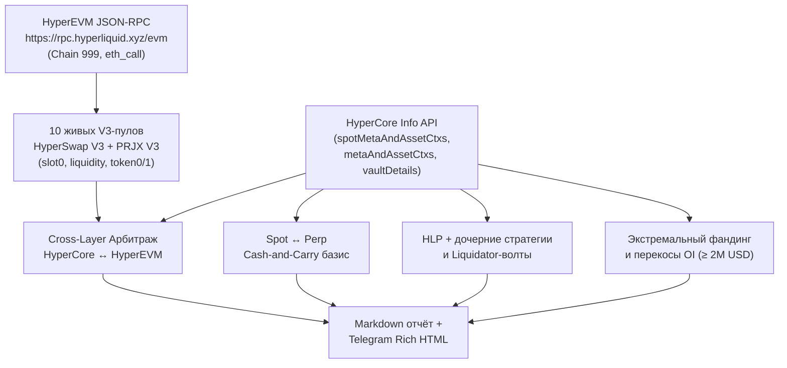

# HyperEVM (Chain 999), HLP и On-Chain DeFi сканер

100% read-only on-chain/cross-layer модуль (`src/hl_quant/hl_hyperevm_defi.py`, CLI `scripts/analytics/run_hl_hyperevm_defi_scan.py`, тесты `tests/test_hl_hyperevm_defi.py`), объединяющий **HyperEVM JSON-RPC** и **HyperCore API** без тяжёлых Web3-зависимостей.

---

## Что сканирует модуль

---

## 1. Прямое on-chain чтение пулов HyperEVM V3

Модуль вызывает напрямую стандартные ABI-селекторы Uniswap V3 через `eth_call`:
- `slot0()` (`0x3850c7bd`) → извлекает `sqrtPriceX96`
- `liquidity()` (`0x1a686502`) → активная ликвидность в текущем тике
- `token0()` (`0x0dfe1681`), `token1()` (`0xd21220a7`), `decimals()` (`0x313ce567`)

Точное декодирование спот-цены `token0` в единицах `token1`:
$$\text{price}_{1/0} = \left(\frac{\text{sqrtPriceX96}}{2^{96}}\right)^2 \cdot 10^{\text{dec}_0 - \text{dec}_1}$$

### Подключённые канонические токены (Chain 999) и 10 живых V3-пулов
- Токены: `WHYPE` (18 dec), `USDC` (6 dec), `USDT0` (6 dec), `UBTC` (8 dec), `UETH` (18 dec), `USOL` (9 dec).
- Пулы: `PRJX V3` и `HyperSwap V3` для пар `WHYPE/USDC`, `WHYPE/USDT0`, `UBTC/USDT0`, `UETH/USDT0`, `UBTC/WHYPE`, `UETH/WHYPE` (комиссии `5 б.п.` и `30 б.п.`).

### Живой срез v2 (блок EVM `#52,312,546`, L1 `#1,235,680,830`, газ `0.10 Gwei`)

#### Нативные прекомпилы `L1Read` (`0x0806` markPx / `0x0807` oraclePx / `0x0809` l1BlockNumber)
| Монета | Asset Idx | `L1Read` Mark | `L1Read` Oracle | REST Mark | Дрейф |
|---|---:|---:|---:|---:|---:|
| **BTC** | 0 | 60,476 | 60,509 | 60,476 | **+0.00 б.п.** |
| **ETH** | 1 | 1,690.3 | 1,691.2 | 1,690.3 | **+0.00 б.п.** |
| **SOL** | 5 | 70.849 | 70.886 | 70.840 | +1.27 б.п. |
| **HYPE** | 159 | 60.295 | 60.321 | 60.289 | +1.00 б.п. |

#### Истинный (Peg-Adjusted) Арбитраж + точная V3-глубина на клипе 25k USD
Ончейн-пег (`PRJX V3 USDC/USDT0 1bp`, `0x9429...ebec`): `1 USDC = 1.001108 USDT0` (**дисконт USDT0 `+11.08 б.п.`**). После нормализации все ложные USDT0-сигналы автоматически отсекаются:

| DEX | Пул | Сырой спред | Peg-Adj спред | Комиссии | Net (0-clip) | Вирт. глубина | Slip 25k USD |
|---|---|---:|---:|---:|---:|---:|---:|
| **PRJX V3** | `UBTC/USDT0 5bp` | +21.38 | +10.29 | 10.5 б.п. | ⚪ −0.21 б.п. | 0.11M USD | 2191 б.п. |
| **PRJX V3** | `WHYPE/USDC 5bp` | +1.44 | +1.44 | 9.5 б.п. | ⚪ −8.06 б.п. | **53.97M USD** | **4.6 б.п.** |
| **PRJX V3** | `UBTC/WHYPE 30bp` | −14.54 | −14.54 | 34.5 б.п. | ⚪ −19.96 б.п. | **34.02M USD** | **7.3 б.п.** |
| **HyperSwap V3** | `WHYPE/USDT0 5bp` | +15.25 | +4.16 | 10.5 б.п. | ⚪ −6.34 б.п. | 0.32M USD | 792 б.п. |

---

## 2. HyperCore Spot ↔ Perp Cash-and-Carry базис

Сопоставляет спот-рынки HyperCore (включая Unit-токены `UBTC → BTC`, `UETH → ETH`, `USOL → SOL`, `UZEC → ZEC`, `HXMR → XMR` с точным матчингом `ctx["coin"] == universe["name"]` и scale-guard `0.5..2.0`) с их перпетуалами:
- Пример живого сигнала: **`UZEC / ZEC`** — суточный объём Spot `10.07M USD`, OI Perp `282.3M USD`, базис `-19.59 б.п.`, фандинг **`+24.1% APR`** (`Cash&Carry: Лонг Spot + Шорт Perp`).

---

## 3. Мониторинг HLP и дочерних стратегий / ликвидаторов

Читает `vaultDetails` головного **Hyperliquidity Provider (HLP)** (`0xdfc24b077bc1425ad1dea75bcb6f8158e10df303`), автоматически обходит его `relationship.data.childAddresses` и запрашивает их живые `clearinghouseState`:

| Волт | TVL | APR | Открытых позиций | Номинал | Загрузка маржи |
|---|---:|---:|---:|---:|---:|
| **Hyperliquidity Provider (HLP)** | 152.45M USD | **+15.65%** | 0 (роутер) | 0 | 0.0% |
| **HLP Strategy A** | 3.14M USD | −0.04% | **177** | 2.93M USD | 4.7% |
| **HLP Strategy B** | 3.07M USD | −1.26% | **177** | 3.02M USD | 4.9% |
| **HLP Strategy X** | 100.94M USD | +3.67% | 0 | 0 | 0.0% |
| **HLP Liquidator / 3 / 4** | по 1.00M USD | до −35.73% | 0 | 0 | 0.0% |

---

## 4. Детектор экстремального фандинга (OI ≥ 2M USD)

Автоматически выделяет ликвидные рынки с сильнейшим перекосом ставок и премии (например, в срезе: `CC −180.8% APR`, `GRAM −77.8%`, `TRX −60.9%`, `SKY −47.2%`, `CRV −41.6%`) — готовая воронка кандидатов для контр-фандинга и реверсивного кэш-энд-керри.
