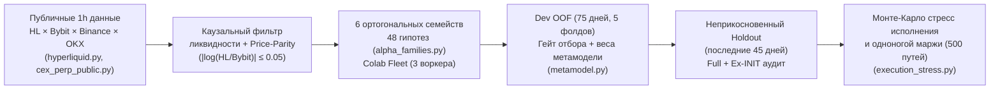

# Hyperliquid · Альфа-фабрика и OOF-Метамодель

Весь крипто-исследовательский стек сосредоточен в `src/hl_quant/` и реализует строгий каузальный цикл без утечек будущего: от сбора многобиржевых часовых данных до 6-семейной метамодели и Монте-Карло стресс-теста исполнения.

---

## Архитектура исследовательского пайплайна

---

## Модули и CLI

| Компонент | Файл | Назначение |
|---|---|---|
| Сборщик Hyperliquid | `src/hl_quant/hyperliquid.py` | Почасовой фандинг, свечи, `predictedFundings`, `metaAndAssetCtxs` |
| Сборщик CEX (3 площадки) | `src/hl_quant/cex_perp_public.py` | Публичные фандинг и 1h klines Bybit, Binance, OKX |
| Отбор вселенной | `src/hl_quant/universe_selection.py` | Train-only отбор ликвидных перпов без lookahead |
| Walk-forward и слоты | `src/hl_quant/walk_forward.py` | Rolling walk-forward + динамические `active_slots` |
| 6 семейств альф | `src/hl_quant/alpha_families.py` | 48 гипотез, каузальная маска `causal_liquid_mask`, корректный учёт смены CEX-ноги (PR #13) |
| Метамодель | `src/hl_quant/metamodel.py` | Отбор ортогональных компонент на Dev, схемы `shrinkage_sharpe`, `inverse_vol`, `equal_weight`, vol-target |
| Монте-Карло стресс | `src/hl_quant/execution_stress.py` | 500 путей трения исполнения, промахов лимиток и одноногого шока маржи |
| CLI и флот | `scripts/analytics/run_hl_colab_shard.py`, `build_hl_metamodel.py`, `run_hl_metamodel_stress.py`, `scripts/ops/run_hl_colab_fleet.sh` | Параллельный расчёт на 3 Colab-шардах и локальная сборка |

---

## 6 протестированных семейств альф (48 гипотез)

1. **`funding_carry_arb` (10)** — дельта-нейтральный funding-carry HL против Bybit и против `best_cex` (Bybit/Binance/OKX) с активными слотами и фильтром базиса.
2. **`basis_mean_reversion` (8)** — дельта-нейтральный возврат спреда `log(hl_close / bybit_close)`.
3. **`hl_xs_funding_contrarian` (9)** — однобиржевая dollar-neutral стратегия на HL: шорт перегретого фандинга / лонг отрицательного.
4. **`hl_xs_price_reversal_mom` (10)** — кросс-секционная реверсия (`4h–48h`), моментум (`72h–336h`) и бленд с фандингом на HL.
5. **`hl_xs_velocity_div` (5)** — ускорение фандинга, дивергенция HL vs CEX и объёмные шоки.
6. **`ml_walkforward_ranker` (6)** — purged walk-forward `Ridge` и `HistGradientBoostingRegressor` по 14 каузальным кросс-секционным признакам.

### Защита от скрытых ловушек данных
- **Каузальный price-parity guard:** фильтр `|log(hl_close / bybit_close)| <= 0.05` (по 72h скользящей медиане) автоматически исключает тикеры с расхождением масштаба (например, 100× разницу цены `PURR` на HL и `PURRUSDT` на Bybit).
- **Учёт издержек смены CEX-ноги (PR #13):** при переключении `best_cex` между Bybit, Binance и OKX модель начисляет полную стоимость закрытия старой CEX-ноги и открытия новой.
- **Аудит выбросов (`Ex-INIT`):** все результаты Holdout публикуются в двух колонках — полные и очищенные от аномального эпизода монеты `INIT`.

---

## Итоговые метрики метамодели (70 монет, 180 дней, после PR #13)

Гейт отбора на Dev 75d (5 фолдов по 15 дней): `dev_sharpe >= 0.5`, `dev_stressed_sharpe >= 0.0`, доля положительных фолдов `>= 80%`, попарная корреляция `< 0.50`. Отобраны 3 ортогональных компонента (`carry_best_cex_L168_in5`, `xs_rev_L24_r12`, `xs_mom_L72_r24`).

| Метамодель (веса обучены строго на Dev) | Dev 75d (APR / Sh / DD) | Holdout 45d (APR / Sh / DD) | Holdout Стресс | Ex-`INIT` Holdout | Ex-`INIT` Стресс |
|---|---|---|---|---|---|
| **`shrinkage_sharpe` (1x)** | +23.62% / 2.29 / −2.91% | **+32.18% / 3.11 / −2.89%** | +22.07% / 2.13 | **+22.37% / 2.33 / −3.28%** | +12.21% / 1.27 |
| **`inverse_vol` (1x)** | +21.24% / 2.25 / −2.24% | +24.95% / 2.54 / −2.74% | +15.80% / 1.60 | +17.07% / 1.88 / −2.88% | +7.87% / 0.87 |
| `equal_weight` (1x) | +23.39% / 2.24 / −2.50% | +24.36% / 2.28 / −3.27% | +14.18% / 1.33 | +19.29% / 1.92 / −3.24% | +9.07% / 0.90 |
| `shrinkage_sharpe_vt12` (≤3x) | +29.53% / 2.32 / −4.12% | +33.01% / 2.62 / −3.83% | +20.67% / 1.64 | +26.64% / 2.13 / −4.65% | +13.58% / 1.09 |

---

## Монте-Карло стресс исполнения и маржи (500 путей, Holdout 45d)

| Сценарий (новые Dev-веса, 1x) | Full Holdout (med APR / Sh / P>0) | Ex-`INIT` Holdout (med APR / Sh / P>0) |
|---|---|---|
| `base_maker` | +32.18% / Sh 3.11 / 100% | +22.38% / Sh 2.33 / 100% |
| `mild_l2_friction` (15% промахов, 0–2 б.п. slip) | **+23.44% / Sh 2.26 / 100%** | **+13.45% / Sh 1.40 / 100%** |
| `harsh_limit_misses` (30% промахов, +7 б.п.) | +9.07% / Sh 0.87 / 100% | −1.39% / Sh −0.14 / 28% |
| `extreme_stress` (50% промахов, +12 б.п.) | −17.55% / Sh −1.65 / 0% | −28.27% / Sh −2.85 / 0% |

**Буфер одноногой маржи HL до ребалансировки залога:**
- `1x`: худшая 72h просадка одной ноги `−4.62%` → свободная маржа `>= 15.0%`.
- `2x`: `−9.24%` → свободная маржа `>= 23.1%`.
- `3x`: `−13.86%` → свободная маржа `>= 34.6%`.

**Ключевой вывод (до замера BBO):** при идеальных `1.5 б.п.` метамодель критически зависела от качества пассивного `ALO`-исполнения (**fill rate ≥ 85%**), что и мотивировало прямой 60-минутный замер `bbo + trades` по всем 19 монетам портфеля (PR #16–#19).

---

## Аудит на измеренных издержках исполнения (PR #16–#19, `5.0 б.п.`)

После исправления `hl_microstructure.py` на поблочный фид **`bbo`** (PR #16) 60-минутная запись (`180 873` BBO-тика, `43 513` сделок, клип `5k USD`) по 19 монетам портфеля показала:
- **Медианный `ALO fill rate` = 55%** (порог 85% прошли только `VVV 90%`, `ZEC 88%`, `HYPE 85%`).
- **30-секундный markout отрицательный у всех 19 монет** (`−0.35…−6.5 б.п.`).
- **Реальная полная стоимость пассивной HL-сделки = `5.0 б.п.`** (почти равна тейкеру `5.6 б.п.`).

| Сценарий издержек (HL / Cross-Venue) | Прошло гейт Dev (из 58 гип.) | Dev 75d (APR / Sh) | Holdout 45d (APR / Sh) | Holdout Ex-`INIT` |
|---|---|---|---|---|
| Прежний (`1.5 / 3.5 б.п.`) | 3 гипотезы | +23.62% / 2.29 | +32.18% / 3.11 | +22.37% / 2.33 |
| **Измеренный (`5.0 / 7.0 б.п.`, PR #17)** | 1: `carry_best_cex_L168_in5` | +2.12% / 0.79 | +34.39% / 4.60 | **−0.37% / −0.19** |

Проверка 10 заранее зафиксированных **замедленных версий `xs_rev`** (`slow_reversal_registry`, PR #18: ребаланс `24–48ч`, `ema_alpha=0.5`, 8 монет на сторону) снизила оборот в `1.5–3×`, но ни один вариант не прошёл Dev-гейт (фолды 2–4 глубоко в минусе, последний фолд и Holdout в плюсе → реверсия зависит от рыночного режима).

**Итоговое решение:** не подгонять фильтр режима под 180-дневную историю, перевести `run_hl_metamodel_paper_tick.py` на измеренную цену **`5.0 б.п.`** (PR #19) и держать метамодель строго в режиме **observation-only** (без реального капитала).

Подробные отчёты: `docs/reports/2026-11-26/hl_alo_fill_portfolio_coins.md`, `hl_metamodel_real_costs.md`, `hl_xs_rev_slow_variants.md`.
