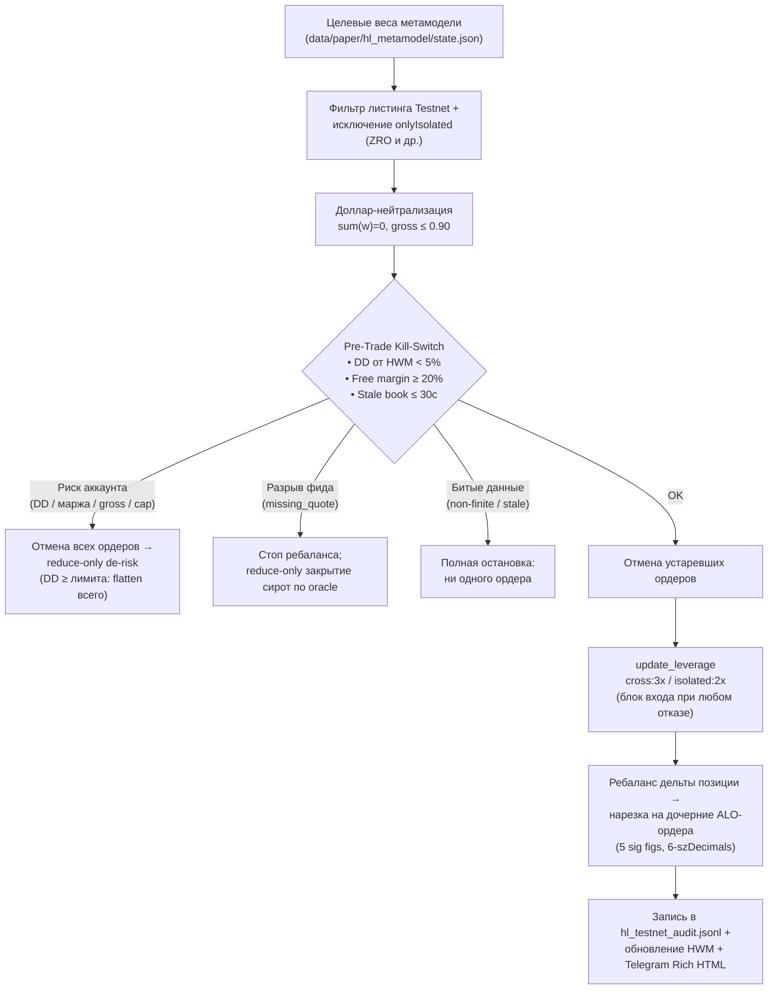

# Testnet `ALO` экзекутор и Пост-трейд атрибуция

Боевой контур исполнения на **Hyperliquid Testnet** (мок-USDC, нулевой риск реальных средств) с жёсткими риск-гейтами, защитой от `onlyIsolated`-ликвидаций и ежедневным пост-трейд аудитом в Telegram.

---

## 1. Testnet `ALO` Экзекутор (`hl_testnet_executor.py`)

**Файлы:** `src/hl_quant/hl_testnet_executor.py`, `scripts/analytics/run_hl_testnet_executor.py`, `scripts/ops/run_hl_testnet_executor_tick.sh`, `scripts/ops/install_local_hl_testnet_cron.sh`.

### Контракты безопасности и точности
1. **Жёсткая привязка к Testnet:** URL зашит как `TESTNET_API_URL = "https://api.hyperliquid-testnet.xyz"`, режим по умолчанию — `dry-run`. Для реальной отправки на Testnet нужен явный флаг `--execute-testnet` и ключи API-кошелька без права вывода (`HL_TESTNET_PRIVATE_KEY`, `HL_TESTNET_ACCOUNT_ADDRESS`) в gitignored `.env`.
2. **Точные правила округления Hyperliquid:**
   - Цена: `<= 5` значащих цифр и `<= 6 - szDecimals` знаков после запятой; для безопасности post-only покупки округляются вниз (`floor`), продажи — вверх (`ceil`), исключая случайный taker-кросс.
   - Размер: округление вниз до `szDecimals`, минимальный номинал `>= 15 USD` для набора позиции, а для полного `reduce_only`-закрытия (при `target_w == 0` или полном закрытии орфана) долларовый порог снят (`0.00 USD`, требуется лишь `rounded_sz > 0`, а остаток округления при нарезке отдаётся последнему слайсу), позволяя полностью убирать суб-долларовые остатки вроде `$0.26` (биржевой лимит `$10` действует только на ордера, увеличивающие позицию).
3. **Защита от `onlyIsolated` / `strictIsolated` ловушек:**
   - `fetch_testnet_meta` читает флаги `onlyIsolated` и `marginMode` (на Testnet 19 из 213 активов — строго изолированные, например `ZRO`).
   - По умолчанию `allow_only_isolated=False`: такие монеты исключаются из целевых весов до нейтрализации, а уже открытые позиции автоматически закрываются пассивным `reduce_only ALO`.
   - При явном `--allow-only-isolated` плечо принудительно снижается до `default_isolated_leverage=2x`; если биржа отклонила смену плеча, вход блокируется.
4. **Точный учёт Unified Account:**
   - Через `userAbstraction` + `spotClearinghouseState` + `clearinghouseState` определяется режим аккаунта.
   - В режиме `unifiedAccount` / `portfolioMargin` поле `spot.USDC.total` уже включает заблокированную маржу Perps и живой Unrealized PnL (проверено до 6-го знака против `portfolio.day.accountValueHistory`).
   - `equity_usd = spot.USDC.total`, `free_margin_usd = max(0, spot.USDC.total - spot.USDC.hold)` — без двойного учёта маржи и без ложных срабатываний drawdown kill-switch.
5. **Kill-switch не замораживает убытки:**
   - Нарушения риска аккаунта (`drawdown_limit`, `low_free_margin`, `gross_leverage`, `coin_cap`) отменяют все ордера адреса и затем ставят только `reduce_only` ALO к целевым весам. При пробое drawdown-лимита (`flatten_on_drawdown=True`) закрываются все позиции.
   - `missing_quote` (разрыв фида Testnet) останавливает ребаланс по BBO, но разрешает пассивное закрытие сирот.
   - `non_finite_*`, `zero_or_negative_equity`, `stale_feed` — полная остановка без единого ордера.
   - Режим цикла пишется в аудит как `derisk_mode`: `flatten`, `reduce_only`, `orphan_unwind_only` или `none`.
6. **Сироты (позиции без двустороннего стакана) закрываются:** `plan_orphan_unwind_orders` ставит `reduce_only` ALO по oracle-цене (`metaAndAssetCtxs`) с учётом уцелевшей стороны стакана: продажа строго выше лучшего bid, покупка строго ниже лучшего ask. Если монета всё ещё в целях стратегии, урезается только излишек сверх целевого размера, а позиция противоположного знака закрывается полностью.
7. **Изоляция от MM на общем адресе:** id ордеров из `data/paper/hl_mm_testnet/mm_audit.jsonl` и монеты из `HL_MM_COINS` (или `--mm-coins`) считаются чужими. Executor не отменяет эти ордера (кроме аварии по риску аккаунта) и не закрывает в ноль нецелевой инвентарь MM; его gross резервируется при нейтрализации и учитывается в gross kill-switch.
8. **HWM с мультипликативным учётом выводов и пост-flatten re-anchoring:** в `hl_testnet_hwm.json` вместе с пиком хранится `net_external_flow_usd` (внешние USDC-потоки из `userNonFundingLedgerUpdates` без внутренних `accountClassTransfer`) и метка аварийного закрытия. При выводе капитала пик масштабируется **мультипликативно** пропорционально доле оставшегося капитала, сохраняя инвариантной текущую процентную просадку `DD%` (в отличие от аддитивного вычитания, которое раздувало относительную просадку оставшегося баланса и могло ложно защёлкивать `drawdown_limit`), а при депозите сдвигается аддитивно без ложной фиксации прибыли. После срабатывания `derisk_mode == "flatten"` и завершения периода охлаждения (post-flatten cooldown) на плоском портфеле HWM автоматически перепривязывается (re-anchoring) к текущему `oracle_adjusted_equity_usd`, исключая вечную блокировку экзекутора после отработанной просадки. Если ledger временно недоступен, сохранённый пик не перезаписывается.

---

## 2. Пост-трейд атрибуция сделок и аудит ликвидаций (`hl_post_trade_attribution.py`)

**Файлы:** `src/hl_quant/hl_post_trade_attribution.py`, `scripts/analytics/run_hl_testnet_attribution.py`, `scripts/ops/run_hl_testnet_attribution_daily.sh`, `scripts/ops/install_local_hl_attribution_cron.sh`.

100% read-only модуль, запускаемый **каждые 4 часа (`22 */4 * * *`)** в контейнерном `worker` (и ежедневно в **09:00 UTC** в локальном cron, дополненный 15-минутным риск-зондом `testnet_risk_probe` `2-59/15 * * * *`), собирающий `userFills`, пагинированный `userFunding`, `userNonFundingLedgerUpdates`, `clearinghouseState`, `spotClearinghouseState`, `openOrders`, `allMids`, 1m `candleSnapshot`, `userAbstraction` и локальный `hl_testnet_audit.jsonl`:

- **Полная раскладка PnL:** `Net PnL = Realized Price PnL + Unrealized PnL + Funding + Fees` (сходится с балансом Unified Account до цента, а внешний депозит считается по `userNonFundingLedgerUpdates` без двойного счёта `accountClassTransfer`).
- **Метрики исполнения:**
  - Доля пассивного **Maker**-объёма (`crossed == False`);
  - Фактическая эффективная комиссия в б.п.;
  - **Реальный ALO Fill Rate** (пересечение `oid` из аудит-лога с живыми `userFills` и `openOrders`, выровненное по окну при лимите `2000` сделок);
  - Истинный пост-филл **VW Markout на горизонте `+60s`** (`vw_markout_bps` по закрытым 1-минутным свечам `candleSnapshot` после каждой сделки — чистая мера adverse selection), строго отделённый от направленного дрейфа **`vw_mark_drift_bps`** (цена исполнения против текущего `mid` спустя часы/дни).
- **Аудит риска маржи, ADL-очереди и API Rate-Limit:**
  - Рассчитывает дистанцию до ликвидации по биржевой `markPx` (с учётом знака позиции: `(markPx - liqPx) / markPx` для лонга и `(liqPx - markPx) / markPx` для шорта) и выдаёт предупреждения при `< 15%`;
  - Считает **`adl_rank_score`** строго по прибыльным (`uPnL > 0`) позициям с точным знаменателем: для `isolated` — изолированная `marginUsed` позиции, для `cross` — `accountValue` соответствующего DEX (у каждого HIP-3 деплоера своя очередь ADL);
  - Мониторит **`api_quota_health`** с учётом `-90%` веса объёма в `Growth Mode` (`0.1×`) и масштабирования безопасного порога `fill rate` под реальный средний размер ордера (`1%` при `100 USD`, `0.05%` при `2 000 USD`).
- **Сверка Testnet vs Paper L2:** сравнивает накопленную доходность живого Testnet-счёта с параллельным Paper L2 трекером.

### Живой аудит на Testnet (аккаунт `0x6b9C2...73afD`)
- **Сверка баланса:** стартовый дроп `999.00 USD − 0.18 USD (Net PnL) = 998.82 USD` — совпадение до цента.
- **Качество исполнения:** 30 сделок, оборот `490.86 USD`, **100.0% Maker**, фактическая комиссия ровно **1.50 б.п.**, реальный **ALO Fill Rate 92.3% (`12/13`)**, VW Markout `-0.70 б.п.`.
- **Практическая ценность риск-аудита:** на первом же запуске модуль выявил, что `ZRO` открылся в биржевом дефолте `isolated:10` с дистанцией до ликвидации всего **5.1%** (против `>2000%` по cross-позициям). После включения защиты `onlyIsolated` экзекутор пассивно закрыл `ZRO` (`reduce_only ALO`), обнулив риск.

- **Защита от предрасчётной ловушки `:00` (`is_pre_settlement_neg_funding_trap`):** в окне `T−5m..T0` UTC экзекутор автоматически откладывает открытие новых лонгов (не `reduce_only`) по монетам с `funding APR <= -25%`, обходя доказанный на 17-дневной истории слив `naive_harvest_5m` (`−5.85 б.п.`).
